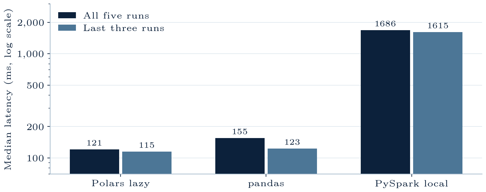
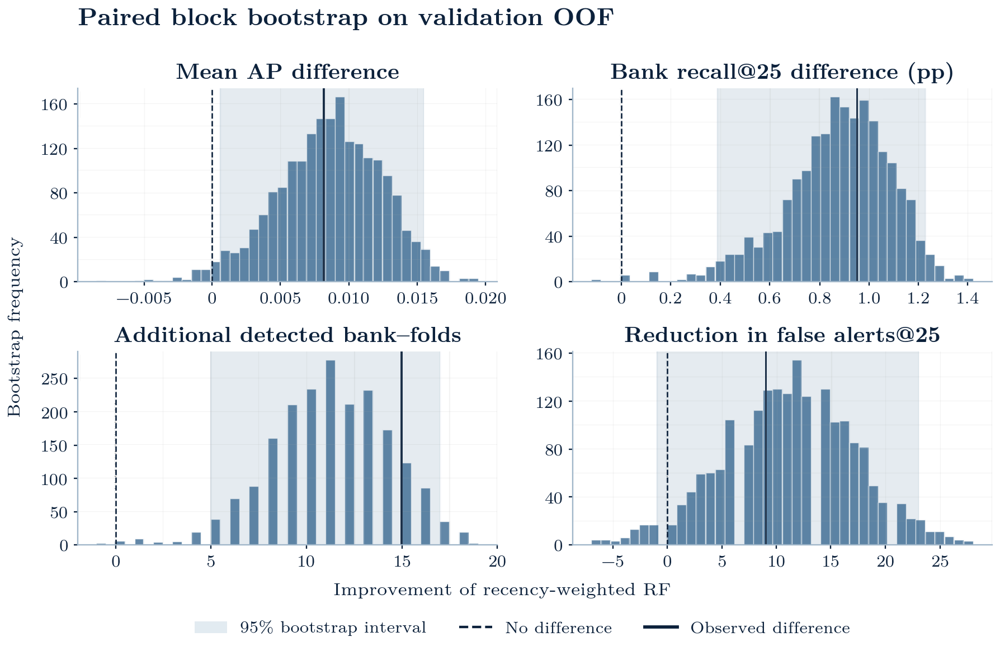
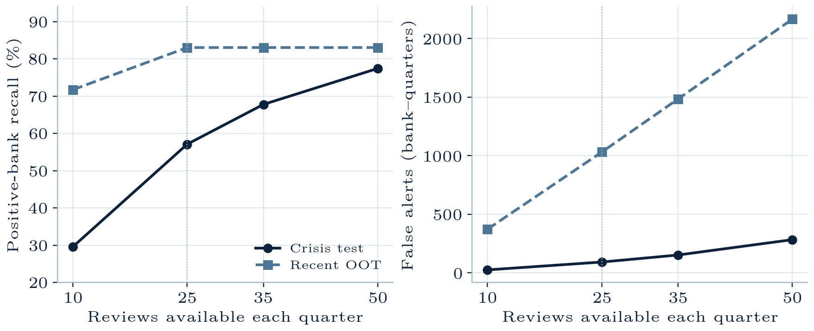

# 

This BFT65B project builds and evaluates a quarterly early-warning queue for U.S. banks using public FDIC records. The target is a qualifying failure within the next four calendar quarters. The practical question is how many distinct at-risk banks a supervisor can identify with a fixed number of reviews each quarter.

<p align="center">
  <a href="LeDucVuong.pdf"></a>
  <a href="notebook_evidence.md"></a>
  <a href="#reproduce-the-project"></a>
</p>

<p align="center">
<a href="#1-acquisition-and-storage">Acquisition</a> &nbsp;·&nbsp; <a href="#2-panel-quality-labels-and-timing">Panel quality</a> &nbsp;·&nbsp; <a href="#3-processing-and-engine-benchmark">Processing</a> &nbsp;·&nbsp; <a href="#4-feature-engineering-and-model-inputs">Features</a> &nbsp;·&nbsp; <a href="#5-development-threshold-transfer-and-frozen-evaluation">Evaluation</a>
</p>

<p align="center">
  
</p>

*The five notebooks trace the pipeline from a literature-backed field contract through acquisition, label construction, feature engineering, and evaluation. Keyed handoffs record the inputs, checks, and outputs of each phase.*

---

## 1. Acquisition and storage

Phase 0 uses a [26-study research matrix](docs/research_matrix.csv) to define the field contract. Phase 1 retrieves quarterly financials and separate institution and event references. A resumable manifest records quarter totals, requests, and checksums. The historical release contains **1,682,616 bank–quarters in 170 quarters**, from 1984Q1 through 2026Q2. This acquisition horizon gives the last model origin, 30 June 2025, enough outcome follow-up.

Across five benchmark years, annual Snappy Parquet saved **47.99%** of storage versus CSV and ZSTD saved **57.01%**. For the 2024 Q1 query, changing the partition layout from annual to quarterly reduced measured read time from **3.976 ms to 1.305 ms**. Storage compression and a quarter-specific access pattern are measured separately. A fresh API extraction can reflect source revisions, so record its manifest before comparing the results with this release.

## 2. Panel quality, labels, and timing

Phase 2 constructs a unique bank–quarter panel keyed by FDIC certificate number and quarter-end. It audits field coverage by era and checks values across the historical and modern source boundary. The archived quality gate passed **20 of 20** checks. An audit of 172,924 rows showed that complete-case deletion would remove **123 of 207 negative-equity rows**. Silver preserves the original nulls and the negative-equity information so that fitted preprocessing can be evaluated inside development folds.

The V3 target credits failures strictly after the origin and through the fourth subsequent quarter-end. It distinguishes dated failures, competing exits, administrative ambiguity, and incomplete follow-up. V3 resolved **71,475** previously missing targets as eligible negatives. Of the **14,316** still missing, **13,070** were right-censored. The stricter eligibility rule excludes the **7,514** flagged administrative exits for sensitivity work.

The event snapshot can mature labels for earlier origins. The feature allowlist keeps event dates and audit outcomes out of the predictor matrix. Phase 2 also evaluates assumed delays between a quarter-end and report availability. The 45-day scenario had **1,096 fewer candidate positive origins** than the zero-delay scenario. The archived run had no verified filing timestamps. An operational replay would require dated releases and revisions as well as the quarterly values.

## 3. Processing and engine benchmark

Phase 3 computes matched ratios and trailing features with pandas, Polars, and local PySpark. The 2024 W1 benchmark uses a 2023 lookback and includes result materialization. The engines agree on the checked output for this benchmark. The recorded median wall times were:

| Engine | 2024 W1 median |
| --- | ---: |
| Polars lazy | 120.65 ms |
| pandas | 155.20 ms |
| PySpark local | 1,686.02 ms |

<p align="center">
  
</p>

*Polars selects 11 of 141 columns for the narrow scan. The report also benchmarks wider reductions and full-history workloads. Local Spark timings cover a laptop workload. A scale-out decision needs a matched test that includes startup, data movement, spill, and writes.*

## 4. Feature engineering and model inputs

Phase 4 builds ratios and exact quarter lags inside each bank history. The four-quarter ROA window requires consecutive observations. A zero or invalid denominator produces a null. Phase 4 joins the engineered panel to the V3 labels by key and applies eligibility after auditing alignment. Selection, imputation, missing indicators, and scaling are fitted on the training side of each fold where the model uses them.

A development comparison reduced the historical candidate set from **113 to 40 features**. Top 40 increased average precision (AP) in each of the three Phase 4 folds.

| Phase 4 fold | Full 113 AP | Top 40 AP |
| --- | ---: | ---: |
| F1 | 0.316454 | 0.329708 |
| F2 | 0.202244 | 0.210561 |
| F3 | 0.153239 | 0.153527 |

Under a Top 1% review budget, Top 40 covered **164 of 194** positive banks in F1, versus **165 of 194** for Full 113. Bank detections were equal in F2 and F3. The compact set preserves almost all observed bank coverage with fewer inputs. The [ordered inventory](lightgbm_top40_inventory.csv) documents the LightGBM incumbent. Under the separate Phase 5 RF comparison, CAMELS 9 detected **229 of 1,576 bank–folds** and the selected 40-feature policy detected **262** at Top 25 per quarter.

## 5. Development, threshold transfer, and frozen evaluation

Phase 5 compares logistic regression, the frozen LightGBM incumbent, and RF variants. Four expanding development folds use a full-year purge to separate fitting from validation. The selected RF uses five-year recency weighting, 60 trees, a maximum depth of 18, a minimum leaf size of 25, and balanced bootstrap class weights. The final RF is refitted on 1985–2006 TRAIN before scoring Crisis (2008–2012) and Recent OOT (2014Q1–2025Q2).

<p align="center">
  
</p>

*The paired four-quarter moving-block bootstrap uses 2,000 replicates of saved out-of-fold predictions. At Top 25, recency weighting gains 15 bank–folds over fixed RF T2. The observed bank recall gain is 0.952 percentage points, with a 95% percentile interval of 0.386 to 1.228 points. The false-alert reduction interval spans zero.*

**Threshold transfer.** Maximizing the F-score with β = 3 on F1–F3 OOF selects a raw-score cut of **0.191913**. In the F4 sensitivity check, cuts of 0.17272, 0.191913 and 0.23989 each catch **7 of 12** positive banks, with **522, 466 and 337** false alerts respectively. On F1–F3, the highest cut detects **42 fewer** positive bank–folds than the selected cut. The official test uses the frozen **0.191913** cutoff. The Top 25 policy below separately ranks banks and fixes workload at 25 reviews each quarter.

**Development sensitivity and audit.** The four supplementary comparisons use saved development OOF scores. At the 0.50% avoidable-loss assumption, an exhaustive search selects **0.172676646** on F1–F3 as a scenario threshold. The prior six-cut grid remains documented separately, and the frozen score rule remains **0.191913302**. Filtering 2,271 uncertain OOF rows increases mean AP from 0.26121 to 0.28683, with 1,444 of 1,576 bank–folds detected at the fixed cost cut in each population. Delaying scores by one quarter on matched rows reduces mean AP from 0.25589 to 0.17832. Earlier-fold calibration improves F4 Brier loss relative to raw scores, and the original calibrator remains in the archived release. Phase 1 records six complete quarterly metadata checks across 170 quarters, with no retained per-page hashes or retrieval times across 8,835 logged pages. The reproducibility audit verifies six hashes, documents five presence checks, and checks the Gold schema and frozen-specification digest.

**Frozen Top 25 scorecard.** The primary archived scorecard uses the frozen release through 2025Q2. The capacity and calibration diagnostics reuse its prediction frames. External predictions were also used for supplementary diagnostics outside model selection and the primary scorecard. Bank recall counts distinct institutions detected at least once on a positive forecast origin. False alerts count individual bank–quarter reviews.

| Window | Model | Raw AP | Banks detected | Bank recall | False alerts |
| --- | --- | ---: | ---: | ---: | ---: |
| Crisis | LightGBM Top 40 | 0.63926 | 241 / 487 | 49.49% | 112 |
| Crisis | Recency-weighted RF | 0.63361 | 278 / 487 | 57.08% | 92 |
| Recent OOT | LightGBM Top 40 | 0.31188 | 41 / 53 | 77.36% | 1,036 |
| Recent OOT | Recency-weighted RF | 0.37201 | 44 / 53 | 83.02% | 1,031 |

<p align="center">
  
</p>

*Moving from 25 to 35 reviews per quarter catches 52 additional banks in Crisis and adds 60 false alerts. In Recent OOT the same expansion adds 453 false alerts while coverage stays at 44 of 53.*

**Risk scores and probabilities.** Recent OOT isotonic calibration reduces Brier loss from **0.002080 to 0.000786**, while AP falls from **0.372012 to 0.336548**. The retrospective constant-prevalence benchmark has Brier loss **0.000701**. The review queue uses raw scores. Probability use needs further evidence and a benchmark appropriate to the deployment population.

**Implications for Vietnam.** A domestic pilot would need stable institution IDs, comparable capital and nonperforming-loan measures, publication timestamps, and a local event definition covering failures and competing resolutions. A chronological backtest can measure how many distinct banks a fixed quarterly queue finds, when each first alert occurs, and what additional reviews cost. Calibration and the benefit of earlier detection should be estimated locally.

---

## Reproduce the project

Use Python 3.13.7, as recorded by the audit, and JDK 17 or 21 for local Spark. From the repository root, create and activate a virtual environment before installing the hash-pinned [requirements](requirements.txt). Set `JAVA_HOME` to the local JDK and choose the corresponding Python kernel in JupyterLab.

```sh
python -m venv .venv
```

Activate with `source .venv/bin/activate` on macOS or Linux, or `.venv\Scripts\Activate.ps1` in PowerShell.

```sh
python -m pip install --require-hashes -r requirements.txt
python -m jupyterlab
```

Create a local `data/` directory before Phase 0. Keep source snapshots, generated tables, and fitted model artifacts locally. The [FDIC BankFind API](https://api.fdic.gov/banks/docs/) supplies financial and institution records. [FDIC failures and assistance](https://banks.data.fdic.gov/bankfind-suite/failures) supplies event evidence. Exact historical replay requires source snapshots matching the notebook manifests. For a fresh extraction, retain the new handoffs and compare counts and digests before accepting the release.

For schema placement, required data files, and the checkpoint that each phase produces, see the [data and phase handoff guide](docs/data_setup.md).

| Order | Notebook | Checkpoint |
| --- | --- | --- |
| 0 | [Field contract](notebooks/phase%200.ipynb) | Validate the 26-study matrix and saved field handoff. |
| 1 | [Acquisition and Bronze](notebooks/phase%201.ipynb) | Use `RUN_SCOPE='full'`. Check 170 quarters, both references, and the `FULL_SCOPE_PASS` handoff. |
| 2 | [Silver and V3 labels](notebooks/phase%202.ipynb) | Check the Silver digest, target rule, eligibility, and Phase 2 → 3 handoff. |
| 3 | [Processing and engine parity](notebooks/phase%203.ipynb) | Verify upstream digests, W1 output, and the Phase 3 → 4 manifest. Enable the Spark path for parity. |
| 4–5 | [Features, modelling, and evaluation](notebooks/phase%204-5.ipynb) | Run Phase 4 through §4.9F. Continue at §5.0A in the same kernel. For development checks, use §5.3B and its OOF sensitivity cells. Use saved outputs to inspect §5.3D and later results. |

The report cites the merged notebook under its archived name, `nháp_v2`. The notebook records an optional Gold export reuse check failing on mismatched digests in cell 294. Cell 297 verifies the same-kernel Gold path used for the report. A new file-backed run requires a fresh release directory or a correctly matched Gold pair. Preserve hash validation. To inspect the submitted test, read the saved output in §5.4A–B (indices 345–346). The Phase 5 seed is **4903** and the MLlib demo uses **42**. The [evidence map](notebook_evidence.md) locates the saved comparisons. A complete replay requires the matching data and a configured environment.

### Build the report and check the figures

The [final report](LeDucVuong.pdf) contains 20 main pages, nine appendix pages, and one references page. Its editable source is [LeDucVuong.md](LeDucVuong.md) and the generated standalone source is [LeDucVuong.tex](LeDucVuong.tex). With XeLaTeX and Latin Modern installed, run:

```sh
xelatex -interaction=nonstopmode -halt-on-error -jobname=LeDucVuong LeDucVuong.tex
xelatex -interaction=nonstopmode -halt-on-error -jobname=LeDucVuong LeDucVuong.tex
```

After changing the Markdown or [preamble](preamble.tex), regenerate the TeX with Pandoc before compiling:

```sh
pandoc LeDucVuong.md --standalone --from markdown+raw_tex --to latex \
  --no-highlight --metadata title="" -V mainfont="Latin Modern Roman" \
  -V monofont="Latin Modern Mono" -V sansfont="Latin Modern Sans" \
  -V papersize=a4 -V fontsize=12pt -V geometry="top=17mm,bottom=16mm,left=19mm,right=19mm" \
  -V colorlinks=true -V lang=en-US -H preamble.tex -o LeDucVuong.tex
```

[Figure assets](figures/) are supplied as PDF and PNG. `python generate_figures.py` rebuilds them from the recorded evidence, including the saved bootstrap histograms. `python verify_cost_grid.py` checks the development cost scenarios without fitting a model. The full report cites the literature, source data, and cost inputs. The [source-screening record](source_screening.md) explains which research informed the modelling choices.

This is a National Economics University BFT65B final examination project.

---

## AI use

OpenAI ChatGPT and Codex (2026) were used to assist with code development, debugging, methodological discussions, experimental design, result interpretation, report editing, and documentation. Empirical results were obtained from the executed research notebooks. The author remains responsible for the methodology, verification of results, and final submitted content.
